<p align="center">
  <a href="https://aibrahm.github.io/bagl/">
    <picture>
      <source media="(prefers-color-scheme: dark)" srcset="brand/bagl-logo-cream.svg">
      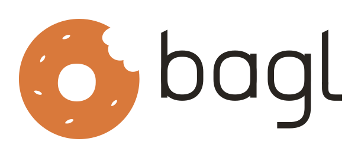
    </picture>
  </a>
</p>

<p align="center">
  A small functional language with tensor shapes in its types and derivatives from the compiler.
</p>

<p align="center">
  <a href="https://aibrahm.github.io/bagl/">Website</a>&nbsp;&nbsp;&nbsp;
  <a href="https://aibrahm.github.io/bagl/playground/">Playground</a>&nbsp;&nbsp;&nbsp;
  <a href="https://aibrahm.github.io/bagl/start/">Get started</a>&nbsp;&nbsp;&nbsp;
  <a href="https://aibrahm.github.io/bagl/reference/">Reference</a>&nbsp;&nbsp;&nbsp;
  <a href="https://aibrahm.github.io/bagl/spec/">Specification</a>
</p>

<p align="center">
  <a href="https://github.com/aibrahm/bagl/actions/workflows/ci.yml"></a>
  <a href="LICENSE"></a>
</p>

Bagl is a statically typed functional language. A tensor's shape is part of its type, so a matrix product with mismatched dimensions is a compile error, and `grad` turns a function into its derivative before type checking. The compiler is written in OCaml, and a JavaScript build of it (about 160 KB, 50 KB compressed) runs [the playground](https://aibrahm.github.io/bagl/playground/) in the browser.

```ocaml
// Gradient descent on XOR. The compiler writes the gradient of the loss,
// and it checks the shape of every step.
let x = [[0.0, 0.0, 0.0],
         [0.0, 1.0, 0.0],
         [1.0, 0.0, 0.0],
         [1.0, 1.0, 1.0]] in
let y = [0.0, 1.0, 1.0, 0.0] in
let dloss = grad (fn w: tensor<float>[3] ->
  let e = dot(x, w) - y in
  dot(e, e)) in
letrec train = fn n ->
  if n < 0.5 then [0.0, 0.0, 0.0] else
  let w = train (n - 1.0) in
  w - 0.1 * dloss w
in train 200.0
// = [0.999987, 0.999987, -1.99996] : tensor<float>[3]
```

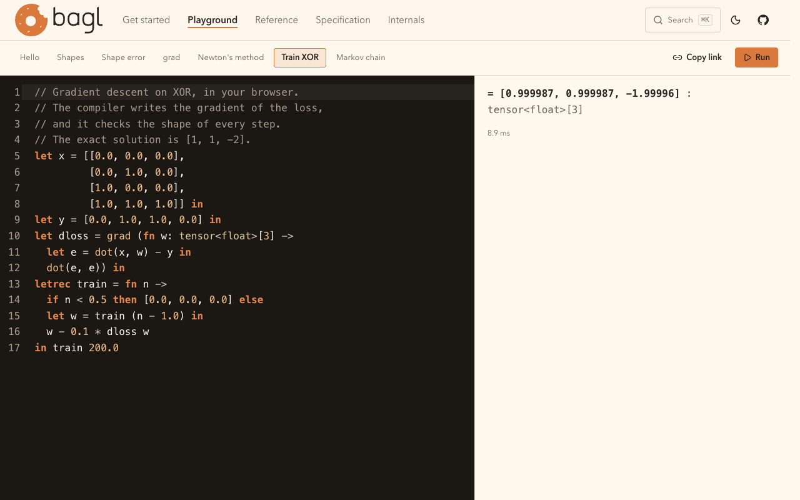

## Features

- Hindley-Milner type inference with let-polymorphism, so you rarely write a type.
- Tensors of rank 1 and 2 with their shapes in the type, including dimension variables like `tensor<float>['n, 'n]`.
- `grad` in three modes: symbolic for scalar functions, reverse mode for tensor parameters, and pathwise for a float parameter in tensor code. A form it can't differentiate exactly is a compile error.
- Element-wise arithmetic, scalar broadcasting, and the math functions `exp`, `log`, `sqrt`, `relu` and `step`.
- An optimizer over basic blocks, a stack bytecode, a virtual machine, and `.baglc` files that save compiled programs.
- A REPL, a language server for editors, and a VS Code extension.

## Install

You need OCaml 5.2 (4.14 and newer also work) and dune.

```sh
git clone https://github.com/aibrahm/bagl.git
cd bagl
dune build
dune test
dune install
```

`dune install` puts `baglc` and `bagl-lsp` on your PATH.

```sh
baglc examples/train_xor.bagl     # compile and run a file
baglc                             # start the REPL
baglc -c program.bagl -o program.baglc
baglc --help
```

[Get started](https://aibrahm.github.io/bagl/start/) covers the REPL, the command line options and the editor setup.

## Documentation

- [Language reference](https://aibrahm.github.io/bagl/reference/), with examples you can edit and run. CI checks each example against the compiler.
- [Specification](https://aibrahm.github.io/bagl/spec/), from the lexical structure to the bytecode format. The source is in [docs/language-spec/](docs/language-spec/).
- [Compiler internals](https://aibrahm.github.io/bagl/internals/), a walk through each stage and the bugs found along the way. The source is [docs/internals.md](docs/internals.md).
- [Design notes](DESIGN.md).

## Repository layout

```text
src/              the compiler: lexer, parser, grad, type inference, IR, optimizer, codegen, VM
bin/main.ml       baglc, the command line and the REPL
js/bagl_js.ml     the entry point for the JavaScript build
lsp/              bagl-lsp, the language server
editors/vscode/   the VS Code extension
examples/         example programs
test/             the test suite
docs/             the specification and internals in Markdown, and the built website
site/             the website's source (React, Vite and Tailwind)
brand/            the logo, colors and brand rules
```

The website is built from `site/` into `docs/`, which GitHub Pages serves. After changing the site, run `npm run build && npm run publish` in `site/`. CI fails if `docs/` doesn't match the source.

## Brand

The logo is a bagel with a bite taken out at the upper right, next to the word "bagl" in custom outlined letters. The files and the rules for using them are in [brand/](brand/), and [brand/README.md](brand/README.md) has the details.

### Logos

<table>
  <tr>
    <td width="50%">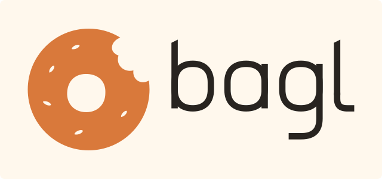</td>
    <td width="50%">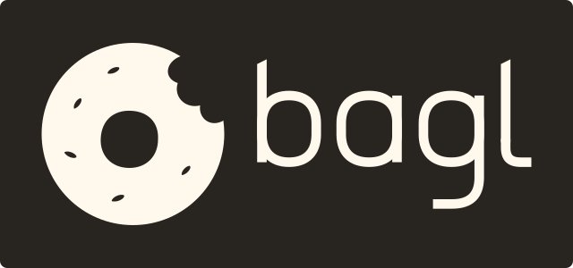</td>
  </tr>
  <tr>
    <td><a href="brand/bagl-logo.svg"><code>bagl-logo.svg</code></a>, for light backgrounds</td>
    <td><a href="brand/bagl-logo-cream.svg"><code>bagl-logo-cream.svg</code></a>, for dark backgrounds</td>
  </tr>
  <tr>
    <td>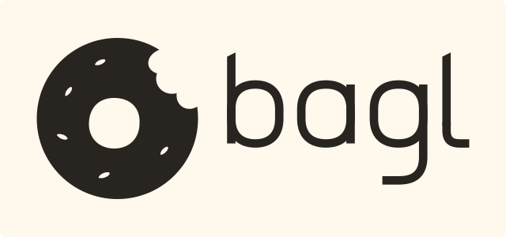</td>
    <td>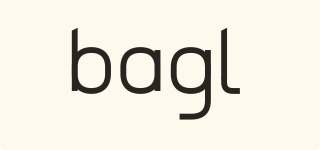</td>
  </tr>
  <tr>
    <td><a href="brand/bagl-logo-ink.svg"><code>bagl-logo-ink.svg</code></a>, in one color</td>
    <td><a href="brand/bagl-wordmark.svg"><code>bagl-wordmark.svg</code></a>, the word alone</td>
  </tr>
</table>

<a href="brand/bagl-logo-ribbon.svg"></a>

`bagl-logo-ribbon.svg` puts the Cream logo on an Ink band, for banners and headers.

### Symbols

<table>
  <tr>
    <td width="25%"></td>
    <td width="25%">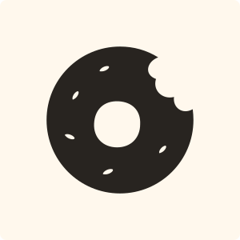</td>
    <td width="25%">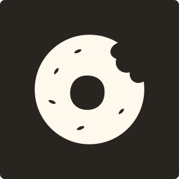</td>
    <td width="25%"></td>
  </tr>
  <tr>
    <td><a href="brand/bagl-symbol.svg"><code>bagl-symbol.svg</code></a></td>
    <td><a href="brand/bagl-symbol-ink.svg"><code>bagl-symbol-ink.svg</code></a></td>
    <td><a href="brand/bagl-symbol-cream.svg"><code>bagl-symbol-cream.svg</code></a></td>
    <td><a href="brand/bagl-symbol-small.svg"><code>bagl-symbol-small.svg</code></a>, for 16 to 24 px</td>
  </tr>
</table>

### Colors

<table>
  <tr>
    <td width="25%">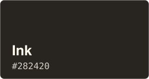</td>
    <td width="25%">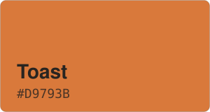</td>
    <td width="25%">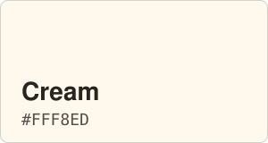</td>
    <td width="25%">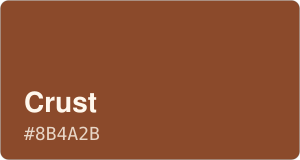</td>
  </tr>
  <tr>
    <td>Text, and dark backgrounds</td>
    <td>Accents, as a fill with Ink text</td>
    <td>Light backgrounds, and text on Ink</td>
    <td>Secondary text and links on Cream</td>
  </tr>
</table>

The interface uses Avenir Next for text and Menlo for code. [brand/tokens.css](brand/tokens.css) has the colors, type sizes, spacing and corner radius as CSS variables.

### Rules

- Leave clear space of at least a quarter of the symbol's width around the logo.
- Don't show the symbol below 32 px or the horizontal logo below 140 px wide. Use the seedless symbol from 16 to 24 px.
- Keep the bite at the upper right, and keep the proportions.
- Use the Cream logo on dark surfaces.

<details>
<summary>The whole brand guide on one page</summary>

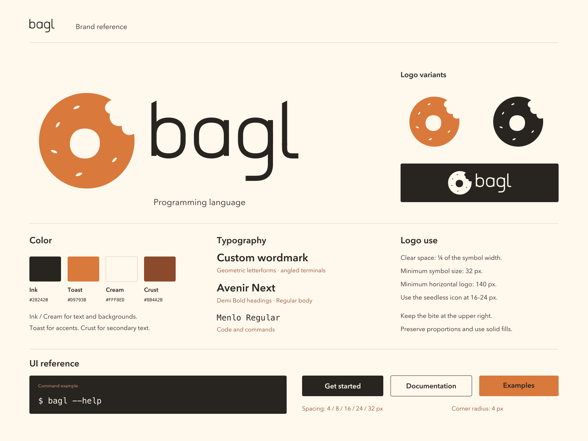

</details>

## License

MIT. See [LICENSE](LICENSE). Third-party code in the website is listed in [site/THIRD_PARTY.md](site/THIRD_PARTY.md).
